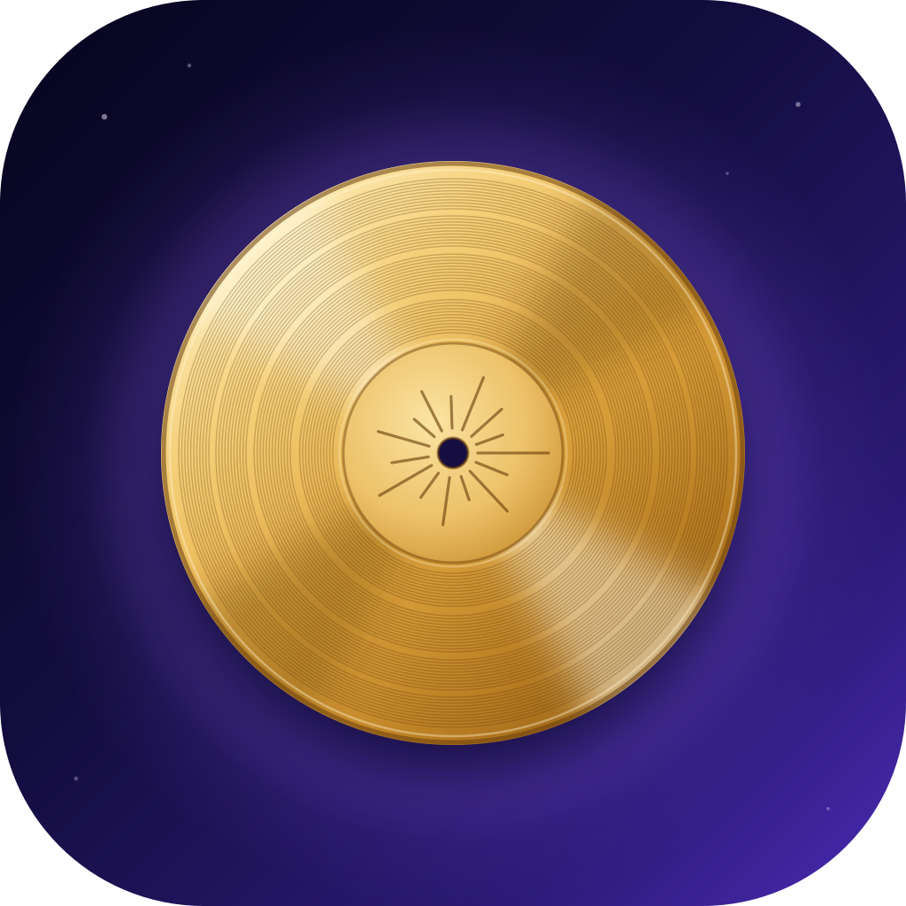
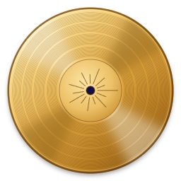

# Voyager



The app is called **Voyager**. The two Voyager probes left Earth in 1977 and are still sending data
home, almost fifty years later, from beyond the edge of the solar system. That is what this app is
for: notes that last. They are plain files on your own server, with every version kept, readable
by any editor long after any particular app is gone.

The name carries three ideas, in this order:

1. **Built to last.** Like the probes, which outlived every plan made for them. Plain Markdown and
   JSON files, full git history, nothing locked in a database or a company's cloud.
2. **Your own Golden Record.** Each probe carries a gold-plated record of what mattered to the people
   who sent it. Voyager is yours: notes, sheets, drawings and tasks in one place.
3. **It goes with you.** On the PC and on the iPhone, live, and in the tray of the desktop app.

It replaces the working name **NotesApp** (renamed 2026-11-03, ROADMAP item 45), which described
the app but could never be anyone's, and which no longer fit an app that is as much spreadsheets,
drawings and tasks as notes.

- **App name:** `Voyager` (the installed web app, the Home Screen label, the desktop app, the
  Windows Start menu, the CasaOS dashboard)
- **Browser tab:** `<page> · Voyager`, `<page> · <vault> · Voyager` in a second vault,
  `Shared · Voyager` on a share page, `Voyager demo` for the live demo
- **Companions:** `Voyager clipper` (the browser extension), `Voyager desktop 1.1.0` (the tray's
  version line), `Voyager Backup` and `Voyager Whisper` (the CasaOS add-on apps)
- **Suggested iPhone Shortcuts:** `Add to Voyager`, `Clip to Voyager`
- **One-line explainer** (manifest, CasaOS, link previews): *Your notes, sheets, drawings and tasks
  in one place: plain files with full history, on every device of your tailnet.*
- **Pitch** (README, social preview): *Your notes, sheets, drawings and tasks, built to last and
  with you on every device.*

## The voice

Voyager talks the way its documentation does: plainly, calmly, and to the point.

- **Say what happens.** "Saved", "Can't reach Voyager. Is Tailscale connected?", "This list was
  written by a newer version of Voyager and is read-only here." The message says what is true and
  what to do next; it never apologises, jokes or shouts.
- **Short sentences, everyday words, second person.** "Your notes", never "the user's data". No
  exclamation marks, no emoji in the interface.
- **The space story stays in the name and the icon.** No "launch", "mission control", "liftoff" or
  "houston" in the interface or the docs: a notes app that makes space puns gets old fast. The one
  place the story is told is here, the README's *Why "Voyager"* and the social preview.
- **Writing the name:** `Voyager`, capital V, the rest lower case. Not "VOYAGER", not "the Voyager
  app", not "Voyager Notes". In running text the app is "Voyager"; when the sentence is about the
  program rather than the product, "the app" is fine ("the app keeps a copy for offline use").
- **Spelling:** British, as in the rest of the repository (licence, colour, behaviour), except in
  code and in names that come from elsewhere.

## Colours

The rename keeps the interface's colours: the purple accent **#8a5cf5** and the tokens in
[`frontend/src/styles/tokens.css`](frontend/src/styles/tokens.css) (named after Obsidian's, so theme
snippets port; every text colour passes WCAG 2.2 AA, checked by `contrast.test.ts`). The ones that
make the brand:

| Token | Dark theme (default) | Light theme | Use |
| --- | --- | --- | --- |
| Brand purple (`--blockquote-border`) | `#8a5cf5` | `#7a4fe0` | The brand colour: the icon's glow, quotes, the README's badges and chips; the base of the selection and tag tints |
| `--interactive-accent` | `#8352f4` | `#7a4fe0` | Fills under white text: buttons, the cursor, selections |
| `--text-accent` | `#aa89f8` | `#6b3fd8` | Text in the accent colour |
| `--tag-fg` | `#b9a2fb` | `#6b3fd8` | Tags, the soft lavender of the chips |
| `--background-primary` | `#1e1e1e` | `#ffffff` | The page (and `theme-color`, so the iPhone's status bar matches) |

Dark is the default theme. The icon adds the space palette below; it is for the icon and the images
around it (the social preview), not for the interface.

## The icon

  

**The Golden Record.** Each Voyager probe carries a gold-plated copper record: sounds and pictures
chosen to tell whoever finds it what life on Earth was like in 1977, with the instructions for
playing it engraved on its cover, among them a map of fourteen pulsars that shows where it came
from. Voyager is your own record of what matters to you. The icon is that disc, face on: gold on
deep space, with fine grooves, a smooth label with the pulsar map engraved on it, and the dark
spindle hole at its centre.

| | |
| --- | --- |
| Space | Gradient from top left to bottom right: `#07051d`, `#130d3e`, `#2b1a76`, `#4b2bb5` |
| Glow | The accent `#8a5cf5` behind the disc (60% at the centre, fading out just past its edge), so the gold sits in a purple halo |
| Disc | 64% of the width, centred; gold from `#fff2c4` at the top left through `#f5d07a`, `#e2a940` and `#b87c22` to `#8e5c16` at the bottom right, with a soft shadow below it |
| Grooves | Fine rings of `#5c3608` at 28% in four tracks with smooth gaps between them, and a highlighted rim |
| Sheen | Two soft light wedges (upper left, lower right) and two faint dark ones across them: the sheen of a pressed disc |
| Label | A lighter gold, 38% of the disc's width, engraved with the pulsar map: fifteen lines from the centre, the long one pointing right |
| Hole | Deep indigo `#160e40`, the background showing through |
| Stars | Six, `#ece6ff` at about 30 to 50%, too faint to survive below about 120 px (on purpose) |

Why it looks like this: most notes apps' icons are a page, a pencil, a notebook or a letter on
a flat colour (the old NotesApp icon was a purple page). A gold disc on deep purple is rare, it is
the probes' own object, and it says "a record that lasts" without a word. A gold circle with a dark
centre stays a record at any size. (The first Voyager icon was Voyager 1's *pale blue dot*, a faint
dot in a sunbeam; it was replaced in November 2026 by this one.)

**Two drawings.** At 64 px and above the icon is drawn from `voyager.svg`. From 48 px down the
grooves and the pulsar map turn to mush, so `voyager-small.svg` makes the disc a little bigger
(78% of the width), turns the grooves into one darker band between a lighter label and a lighter
rim, makes the hole bigger (13% of the width), keeps one light wedge of sheen and drops the stars.
Both have the same space, glow, gold and proportions, so they read as one icon.

**Two variants: the tile and the disc.** The *tile* is the disc on its square of deep space
(`voyager.svg`, `voyager-small.svg`). The *disc* is the Golden Record alone on a transparent
background (`voyager-disc.svg`, `voyager-disc-small.svg`): the same drawing, 92% of the side,
with a darker rim and a soft shadow so it holds on a light taskbar or tab bar as well as a dark
one. Its small drawing uses a slightly deeper gold for the same reason.

| Where | Variant |
| --- | --- |
| The desktop app: the exe, its windows, the taskbar, the Start menu, desktop shortcuts, the tray, the setup and offline pages, notifications, the macOS app icon | The disc (`build/icon.ico` at every size, 16 to 48 px from the small drawing; `build/icon.png`; `src/pages/icon.ico`, `icon.png`, `icon-small.png`) |
| The browser tab (`favicon.svg`) | The disc, small drawing |
| The iPhone's Home Screen (`apple-touch-icon.png`) and the installed web app (`icon-192.png`, `icon-512.png`, `icon-maskable-512.png`) | The tile: iOS and Android need an opaque square (iOS paints transparency black) |
| CasaOS (it shows `icon-192.png`), the README and BRAND.md (`docs/images/icon.svg`), the social preview, the demo vault's logo | The tile |
| The clipper's toolbar and store icons | The tile (16 to 48 px from the small drawing) |

**Using it.**
- As the tile or as the disc, never cropped, recoloured, rotated or outlined, never with text over
  it, and never the disc on a tile of another colour.
- The disc on the PC (the desktop app and the browser tab); the tile everywhere else. The tile is
  rounded (corner radius 22.5% of the side) in the README and the clipper, and full bleed where the
  platform rounds or masks it (the iPhone's Home Screen, Android's maskable icon); the disc stays
  inside a maskable icon's 80% safe zone.
- Under 64 px use the small drawing; never shrink the large one to a favicon.
- Next to the name, the icon goes on the left, as tall as the name's capital letters or a little
  taller (the README, the social preview, the desktop app's first-run page).
- On a light page, give it room: the tile is dark and needs no border.

**Files.** The drawings are in [`scripts/brand/`](scripts/brand): the tile (`voyager.svg`, 1024
full bleed; `voyager-small.svg`, 64) and the disc (`voyager-disc.svg`, 1024; `voyager-disc-small.svg`,
64; both transparent). Edit those, then render everything again:

```sh
cd e2e && npm ci && cd ..                      # once: the scripts use e2e's Playwright
node scripts/brand/render-icons.mjs --preview icon-preview.png   # also a sheet: large, Home Screen, tabs, taskbar
node scripts/brand/render-icons.mjs --preview-pc icon-pc.png      # also a sheet of the disc: taskbar, shortcuts, tabs
node scripts/brand/render-images.mjs           # with the demo build served on :5230 (the script says how)
```

`render-icons.mjs` draws each size on a canvas in headless Edge or Chrome and writes every icon the
apps ship: `frontend/public/` (favicon.svg, the small disc; apple-touch-icon.png, 180, opaque RGB,
because iOS paints transparency black; icon-192 and icon-512 on the rounded tile; icon-maskable-512
full bleed), `docs/images/icon.svg` (the tile), the desktop app's `build/icon.png` (1024),
`build/icon.ico` and `src/pages/icon.ico` (16 to 48 px from the small disc, 64 to 256 from the
large one), `src/pages/icon.png` and `icon-small.png` (all the disc), and the clipper's 16, 32, 48
and 128 px icons (the tile). No image
library and no new dependency. `render-images.mjs` renders the social preview (1280×640, the
repository's and the live demo's link preview) and the two README screenshots that show the name.
The demo vault's `Attachments/voyager-logo.svg` is a copy of `docs/images/icon.svg`.

## What keeps the old name

Only what people read was renamed. Identifiers that something depends on keep `notesapp`, because
renaming any of them would break the live server, an installed app or the data:

| Kept | Why |
| --- | --- |
| The image `ghcr.io/rjgehan/notesapp`, the containers (`notesapp`, `notesapp-backup`, …), `/DATA/AppData/notesapp` | Watchtower updates the running server by the image's name; CasaOS and the backups know the containers by theirs |
| `NOTES_*` environment variables, `notes.*` settings keys, API paths | The server's configuration and every client |
| The vault's `.notesapp/` folder, the `notesapp-sheet` and `notesapp-tasks` file types | The user's data |
| `notesapp:*` local-storage keys, `notesapp-*` service-worker caches, the `notesapp` IndexedDB database | A new name would wipe each device's settings, offline notes and unsent edits |
| `notesapp-clip-*` messages, the clipper's Firefox id `clipper@notesapp.rjgehan.github.io` | An older extension and a newer server (and the reverse) keep working; Firefox keeps the add-on |
| The desktop app's id `com.rjgehan.notesapp.desktop` | The installer finds NotesApp by it and replaces it in place; Windows' taskbar and notifications know the app by it |
| The desktop app's user-data folder `NotesApp` on a computer that had it | Its settings and web storage are there (`desktop/src/userData.js`) |
| The git committer `NotesApp <notesapp@notes>` | It authors the app's own commits in every vault's history; a second name would split the timeline's author filter |
| The repository `rjgehan/notesapp`, the demo at `rjgehan.github.io/notesapp/`, Java packages, the Maven artifactId, npm package names | Links, the Pages URL and the build |

## Still to do by hand

- **iPhone:** a Home Screen app added before the rename keeps the label *Notes* and the old icon;
  iOS never refreshes a web app's name or icon. Check that it says everything is saved, delete it
  from the Home Screen and add it again from Safari (the guide's *Phone tips*). Then subscribe it
  to reminders again if it had Web Push.
- **Windows:** install `Voyager-Setup-1.1.0.exe` once; it replaces NotesApp and keeps its settings.
  Re-pin it to the taskbar if NotesApp was pinned (DESKTOP.md, *Updating from NotesApp*).
- **GitHub:** upload `docs/images/social-preview.png` in the repository's Settings › Social preview,
  and use "Voyager" as the repository's description if you like. The repository's name stays.
- **CasaOS (optional):** paste `deploy/casaos-compose.yml` again to see the new title, description
  and icon in the dashboard; the app itself updates through Watchtower either way.

## A note on the name

"Voyager" is a common word and many products use it. No trademark screening was done: this is a
self-hosted app for one household, not a store listing. Before publishing it under this name (an
app store, a hosted service), get a proper clearance search for note-taking and productivity
software.
