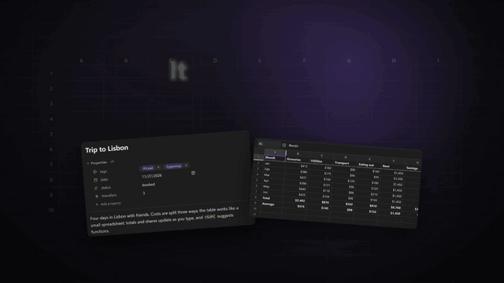
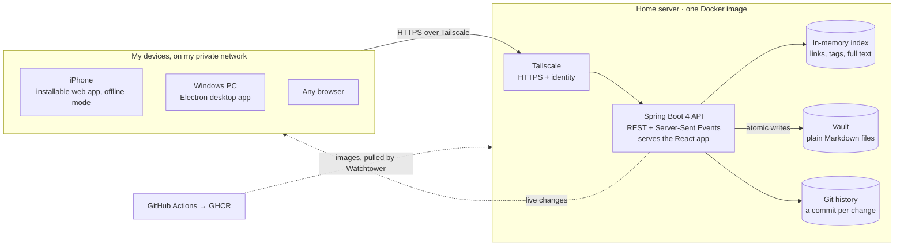

<p align="center">
  
</p>

<h1 align="center">Voyager</h1>

<p align="center">
  <b>Notes and Google-Sheets-style spreadsheets in one app, finally.</b><br>
  A self-hosted, Obsidian-style workspace for notes, spreadsheets, drawings and tasks,<br>
  running on my home server and live on my iPhone and Windows PC.
</p>

<p align="center">
  <a href="docs/media/voyager-demo.mp4">
    
  </a><br>
  <sub>A quick tour. Click it for the full 45-second video with sound.</sub>
</p>

<p align="center">
  <a href="https://github.com/rjgehan/notesapp/actions/workflows/ci.yml"></a>
  
  
  
  
  
  
</p>

---

## At a glance

| | |
| --- | --- |
| **What** | A notes app in the style of [Obsidian](https://obsidian.md), with real spreadsheets built in: notes, Google-Sheets-style sheets (about 400 functions and charts), Excalidraw drawings, canvases, Kanban boards, tasks with reminders, flashcards and habits, all stored as plain files |
| **Why** | I love Google Sheets, and I wanted my notes and my spreadsheets in the same app. That didn't exist, so I built it. Formulas work across both: a table in a note can total itself, and a sentence can quote a spreadsheet cell |
| **Status** | In daily use on my iPhone (an installable web app) and my Windows PC (a desktop app), served from my home server over a private [Tailscale](https://tailscale.com) network. Every push to `main` deploys itself |
| **Size** | ~170k lines of application code (Java 48k, TypeScript 104k, CSS 17k) plus ~80k lines of tests. 109 REST endpoints, 4,600+ automated tests, 694 commits in about three and a half weeks |

## What it does

- **Write without seeing Markdown.** A single Live Preview editor (CodeMirror 6) renders as you type. Tables are editable grids, and any cell takes a spreadsheet formula, with suggestions and click-to-reference like Google Sheets.
- **Spreadsheets that feel like Google Sheets:** formulas, sorting and filters, frozen rows, conditional formatting, drop-downs, find and replace, charts, pivot tables, and copy and paste with Sheets and Excel. A spreadsheet can be embedded in a note and edited right there.
- **Everything else in one place:** Excalidraw drawings, JSON canvases, Kanban boards, a task manager with repeating tasks and push reminders, a calendar, a graph of linked notes, flashcards (FSRS) and a habit tracker.
- **Never lose a keystroke.** Every change is versioned with git and synced live to every open device; conflicting edits from two devices are caught and shown side by side.
- **Family sharing.** Share a note or a folder with family members on the same private network, read-only or editable.
- **Obsidian-compatible.** The same folder opens in Obsidian: wikilinks, embeds, frontmatter, callouts, canvases and Kanban boards use its formats.

<table>
  <tr>
    <td width="50%"><br><b>Spreadsheets</b> with ~400 functions, charts and Excel import and export</td>
    <td width="50%"><br><b>Formulas in notes:</b> change a cost and every total updates</td>
  </tr>
  <tr>
    <td><br><b>Drawings</b> in Excalidraw, merged across devices</td>
    <td><br><b>Tasks</b> with due dates, repeats and reminders, as lists or boards</td>
  </tr>
</table>


<sub>More screenshots and the complete feature list: [docs/FEATURES.md](docs/FEATURES.md).</sub>

## Architecture



- **No database, on purpose.** The vault is a folder of plain files, so it stays readable and portable. An in-memory index of links, tags and full text is built at startup and kept current by a file watcher, and JGit commits every change to the vault's own history.
- **No login screen.** The app only listens inside a private Tailscale network, which supplies each person's verified identity. Allowlists on the host name and identity are the security boundary.
- **One React app everywhere.** The same React 19 + TypeScript front end runs in the browser, as an installable iPhone app, and inside the Electron desktop app. Each file type (notes, sheets, drawings, canvases, tasks, PDFs) loads as its own lazy bundle, so the first load stays under a **350 KiB budget that the build enforces**.

## Engineering highlights

**1. Never losing a keystroke across devices.** Notes are edited on a phone and a PC at once, often offline. Every save carries the file's git blob id ([`FileService.java`](backend/src/main/java/com/rjgehan/notes/vault/FileService.java)): a stale write gets `409 Conflict` instead of overwriting, and the client ([`DocumentSession.ts`](frontend/src/sync/DocumentSession.ts)) merges or shows both versions side by side. Unsaved text is kept as a draft in the browser until the server confirms it, writes are atomic, and Server-Sent Events push every change to every open tab within moments.

**2. One formula engine for notes and spreadsheets.** I wanted Google Sheets inside my notes, not next to them. The spreadsheet engine (HyperFormula) also powers tables in notes ([`formulas/engine.ts`](frontend/src/formulas/engine.ts)), and formulas can read across files: a note can say `='Budget.sheet'!H8` and stay current ([`sheets/links/`](frontend/src/sheets/links/)). Spreadsheets edited on two devices are merged cell by cell ([`merge.ts`](frontend/src/sheets/merge.ts)), not overwritten.

**3. A file-based backend that stays fast at scale.** I built a load-test kit ([`perf/`](perf/)) with a generated 10,000-note vault, a 5 MB note and a 2,000-commit history, profiled the hot paths, and fixed five cliffs with before-and-after numbers ([PERFORMANCE.md](docs/PERFORMANCE.md)). For example, graph zoom with 10,000 nodes went from 340 ms per frame to 10 ms, and searching a huge note from 90 ms to 13 ms.

**4. A real security model for a self-hosted app.** Family members get scoped, revocable shares with their own guest pages ([`ShareService.java`](backend/src/main/java/com/rjgehan/notes/share/ShareService.java)), backed by a written threat model and a security audit ([SECURITY.md](docs/SECURITY.md)). The audit caught that the server's port was reachable from the local network, where identity headers could be forged; I moved the deployment to listen on the server's loopback only.

**5. Finding bugs systematically, not by accident.** Besides the unit and end-to-end suites, I ran a structured bug hunt over the whole codebase: independent reviewers searched each area, other reviewers tried to disprove every finding, and only confirmed bugs were fixed, each with a regression test. Three rounds confirmed and fixed **157 bugs**, from lost keystrokes during app start-up to spreadsheet results that differed from Google Sheets. A manual QA pass is in [`qa/`](qa/2026-11-02/FINDINGS.md).

## Testing and delivery

- **Backend:** about 1,340 JUnit 5 tests, including integration tests against a real temporary vault and git repository, run on both JDK 21 and JDK 25.
- **Front end:** about 3,100 Vitest and Testing Library tests in 300+ files, including one that boots the whole app on a demo vault.
- **End to end:** 89 Playwright tests against the production build, at desktop and iPhone sizes, covering the API, the core editing loop, sync between two devices and offline behaviour. They gate every release.
- **Also tested:** the web clipper (79 tests), the desktop app (51) and the deploy and backup scripts.
- **CI/CD:** [GitHub Actions](.github/workflows/ci.yml) runs all of it on every push. A push to `main` publishes multi-architecture Docker images to GHCR, Watchtower rolls them out on the server within minutes, and open tabs reload themselves onto the new build.
- **Written contracts:** [API.md](docs/API.md) is the binding API contract (a test keeps it identical to the front end's types), and [DESIGN.md](docs/DESIGN.md) records every design decision and why.

## Tech stack

| Layer | Tech |
| --- | --- |
| Backend | Java 21, Spring Boot 4.1 (Web MVC, Actuator), JGit, Server-Sent Events, lib-recur (repeat rules), PDFBox, Web Push, Maven |
| Front end | React 19, TypeScript, Vite, CodeMirror 6, TanStack Query, Zustand, HyperFormula, Glide Data Grid, Excalidraw, Mermaid, KaTeX, PDF.js, d3-force, ts-fsrs, QuickJS (sandboxed scripts) |
| Apps | Installable PWA with a service worker and offline mode, an Electron desktop app, a browser-extension web clipper |
| Testing | JUnit 5, Spring Boot Test, Vitest, Testing Library, Playwright |
| Infra | Docker (multi-stage, amd64 + arm64), GitHub Actions, GHCR, Watchtower, CasaOS, Tailscale, restic backups, ntfy alerts |

## How I built it

I own the product, the architecture and the quality bar:
- I decided what Voyager does, from how I actually take notes and use spreadsheets every day.
- I chose the stack, the file-based design and the security model.
- I set up the testing, the QA and bug-hunting process, and the deployment, and I check every change on my own iPhone and PC.

The code was written with [Claude Code](https://claude.com/claude-code) as an AI pair programmer, working to my direction; most commits carry its co-author line. Working this way, I went from an empty repository to a deployed app with 4,600+ tests in about three and a half weeks.

## Repository layout

| Path | What |
| --- | --- |
| [`backend/`](backend/) | Spring Boot 4 / Java 21 API: files and versions, git history, search index, tasks and reminders, sharing, live sync |
| [`frontend/`](frontend/) | React 19 + TypeScript app: the editor, spreadsheets, drawings and every other view |
| [`desktop/`](desktop/) | Electron desktop app for Windows and macOS |
| [`clipper/`](clipper/) | Browser-extension web clipper |
| [`e2e/`](e2e/) | Playwright end-to-end suite |
| [`perf/`](perf/) | Load-test kit: generated vault, benchmarks, profiling |
| [`deploy/`](deploy/) | CasaOS and Docker Compose files, backup scripts |
| [`docs/`](docs/) | Design, API contract, user guide, security, performance and more |

## Running it locally

Needs JDK 21 and Node 24; Docker is not needed.

```powershell
# Terminal 1: the API, with a throwaway vault in .\dev-vault
cd backend; .\mvnw.cmd spring-boot:run "-Dspring-boot.run.profiles=dev"

# Terminal 2: the app on http://localhost:5173
cd frontend; npm install; npm run dev
```

Or run the front end alone on its in-memory demo data: `$env:VITE_MOCK_API = "1"; npm run dev`. Self-hosting on a home server is covered in [docs/CASAOS.md](docs/CASAOS.md) and [docs/DEPLOY.md](docs/DEPLOY.md).

<details>
<summary><b>All documentation</b></summary>

| Document | What it covers |
| --- | --- |
| [User guide](docs/guide/index.md) | Using the app, task by task (also built into the app as its Help page) |
| [FEATURES.md](docs/FEATURES.md) | Everything the app does |
| [DESIGN.md](docs/DESIGN.md) | The technical design and the reasons behind each decision |
| [API.md](docs/API.md) | The REST and Server-Sent Events contract |
| [DEVELOPMENT.md](docs/DEVELOPMENT.md) | Local development, checks, and how a change reaches the server |
| [DEPLOY.md](docs/DEPLOY.md) / [CASAOS.md](docs/CASAOS.md) | Running it on a home server |
| [DESKTOP.md](docs/DESKTOP.md) | The desktop app |
| [CLIPPER.md](docs/CLIPPER.md) | The web clipper |
| [SECURITY.md](docs/SECURITY.md) | Threat model, audit findings and residual risks |
| [PERFORMANCE.md](docs/PERFORMANCE.md) | Load tests and results |
| [ACCESSIBILITY.md](docs/ACCESSIBILITY.md) | WCAG 2.2 AA status and known gaps |
| [ROADMAP.md](docs/ROADMAP.md) | Every roadmap item and what it became |
| [BRAND.md](BRAND.md) | The name, the story behind it, and the icon |

</details>

<sub>**Why "Voyager":** the Voyager probes launched in 1977 and are still sending data home, and each carries a Golden Record of what matters to us. This app is my own record, built to last: plain files, every version kept. More in [BRAND.md](BRAND.md). The app was called NotesApp until November 2026; the repository and Docker image keep that name. Licensed under [GPL-3.0](LICENSE) (HyperFormula is used under its GPL-3.0 option); third-party licences are in [THIRD_PARTY_NOTICES.md](THIRD_PARTY_NOTICES.md).</sub>
