<div align="center">

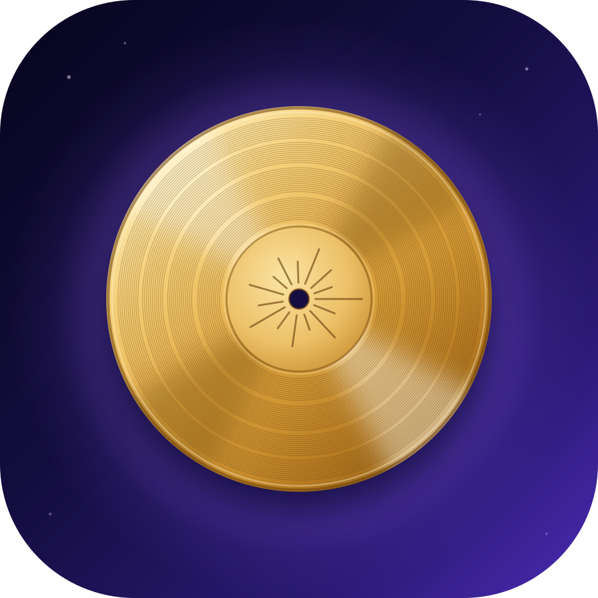

# Voyager

**Your notes, spreadsheets, drawings and tasks in one self-hosted, Obsidian-style app. Plain files on your own server, every version kept, and live on every device you own.**

[](https://github.com/rjgehan/notesapp/actions/workflows/ci.yml)
[](https://rjgehan.github.io/notesapp/)
[](LICENSE)


### [▶ Try the live demo](https://rjgehan.github.io/notesapp/)

It runs entirely in your browser on a sample vault: nothing to install, nothing saved.

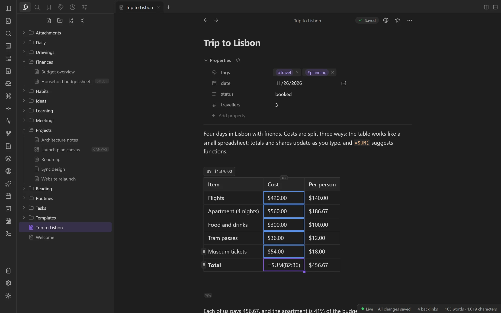

</div>

## What it is

Voyager is a complete notes app that I built for myself and use every day on an iPhone and a Windows PC. It looks and works like [Obsidian](https://obsidian.md), but the vault lives on a home server instead of a sync service: one Docker image, reachable only over a private [Tailscale](https://tailscale.com) network, with every change kept in git.

- **Write without seeing Markdown.** One Live Preview editor (CodeMirror 6) that renders as you type; tables are editable grids whose cells take spreadsheet formulas.
- **More than notes.** Spreadsheets, Excalidraw drawings, canvases, Kanban boards, a task manager, a calendar, a graph, flashcards and a habit tracker, all stored as ordinary files in the vault.
- **Never lose a keystroke.** Atomic writes, version checks with a side-by-side conflict view, drafts kept in the browser until the server confirms them, and a git commit for every change.
- **Live everywhere.** Server-Sent Events push each change to every open tab, the phone app (an installable PWA with offline mode) and the Windows and macOS desktop app.
- **Obsidian-compatible.** Open the same folder in Obsidian: wikilinks, embeds, frontmatter, callouts, canvases and Kanban boards are its formats.

Every feature is explained in the user guide, which is built into the app as its **Help** page: [open it in the live demo](https://rjgehan.github.io/notesapp/x/help), or read it here in [docs/guide](docs/guide/index.md).

**Why "Voyager".** The Voyager probes were launched in 1977 and are still sending data home. This app is built to last in the same way: your notes are plain files, and every change is kept. Each probe carries a Golden Record of what matters to us; this is your own, with notes, sheets, drawings and tasks in one place. And it travels with you, on the PC and on the iPhone. The icon is Voyager 1's *pale blue dot*, Earth as a speck in a sunbeam. More in [BRAND.md](BRAND.md). (The app was called NotesApp until November 2026; the repository and the Docker image keep that name.)

## See it in action

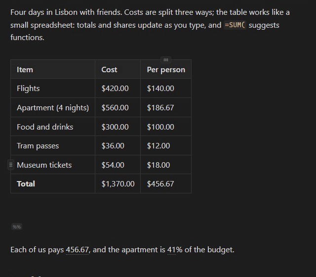

*A table in a note works like a small spreadsheet: change a cost and the totals, the shares and the inline formula below update as you type.*

| | |
|:---:|:---:|
| 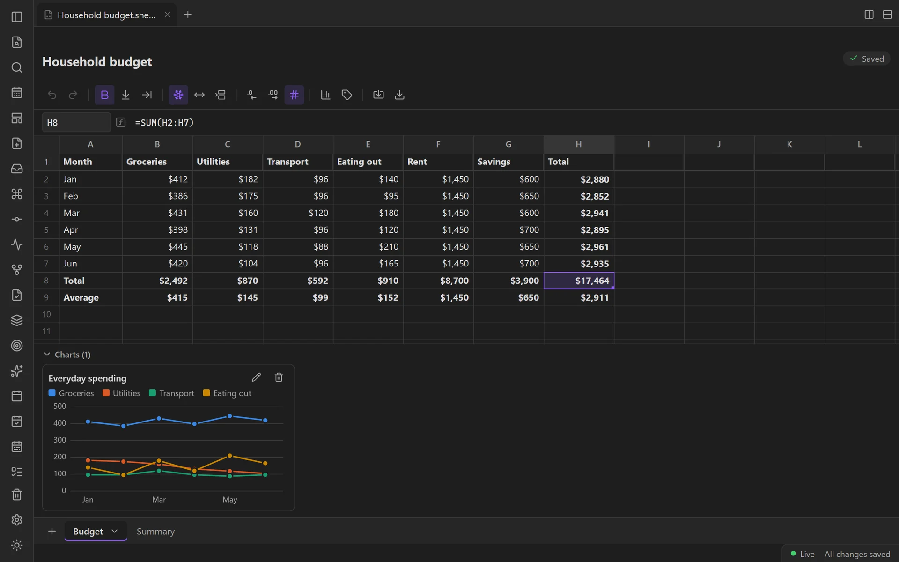<br>**Spreadsheets** with ~400 Google-Sheets functions (HyperFormula), charts, and CSV and Excel import and export | 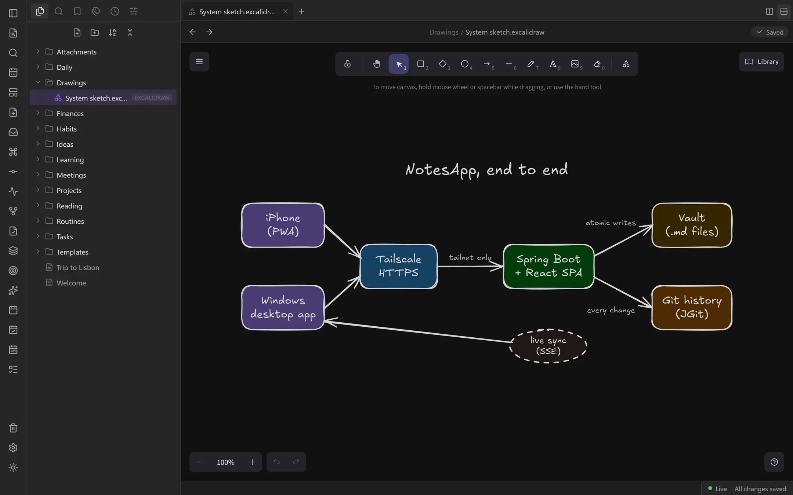<br>**Drawings** in Excalidraw, stored in the vault, merged across devices and embeddable in notes |
| 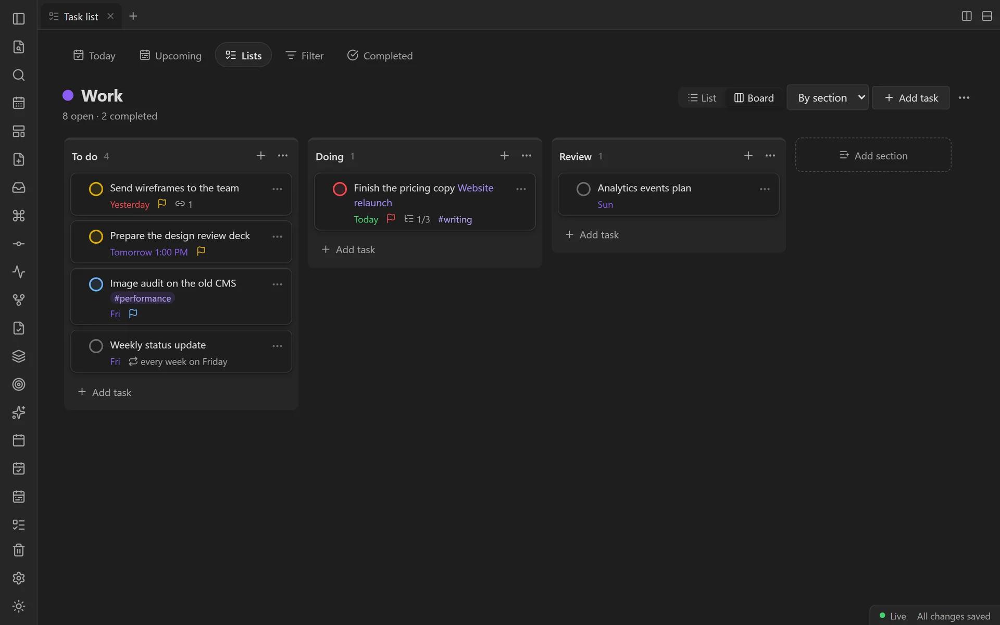<br>**Tasks** with due dates, priorities, subtasks and repeating rules, as lists or Kanban boards | 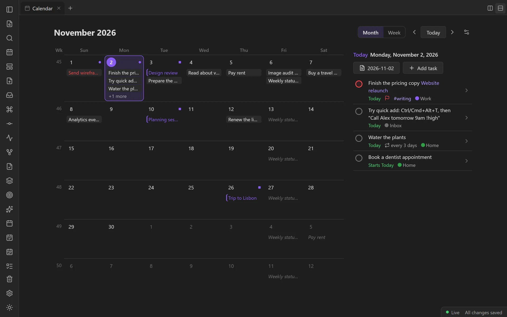<br>**Calendar** of daily notes, tasks and notes dated by a property |
| 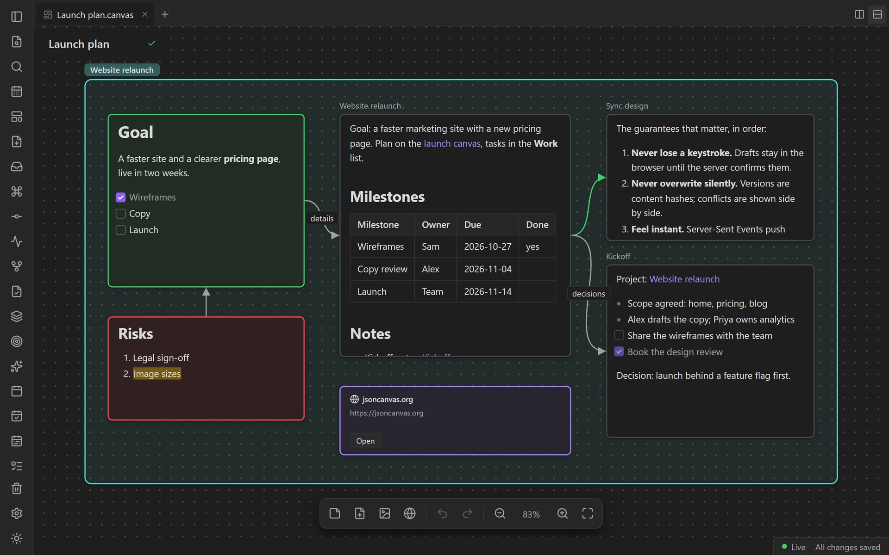<br>**Canvases** in Obsidian's JSON Canvas format | 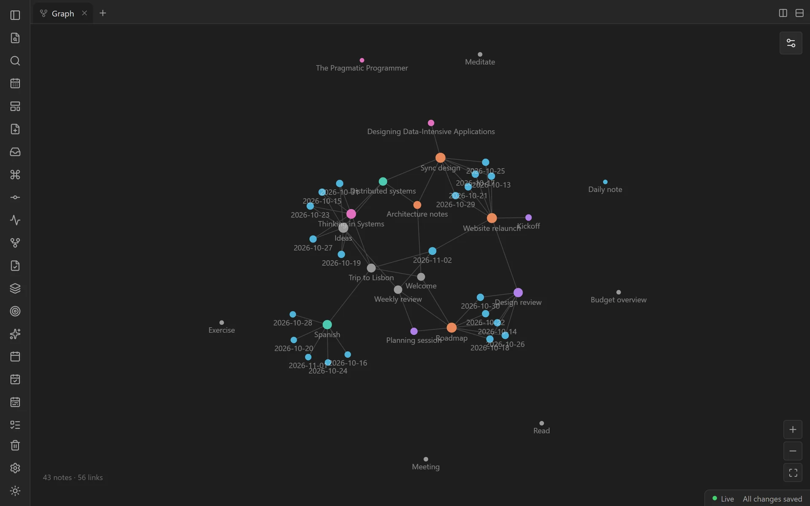<br>**Graph** of every note and link, laid out in a Web Worker |
| 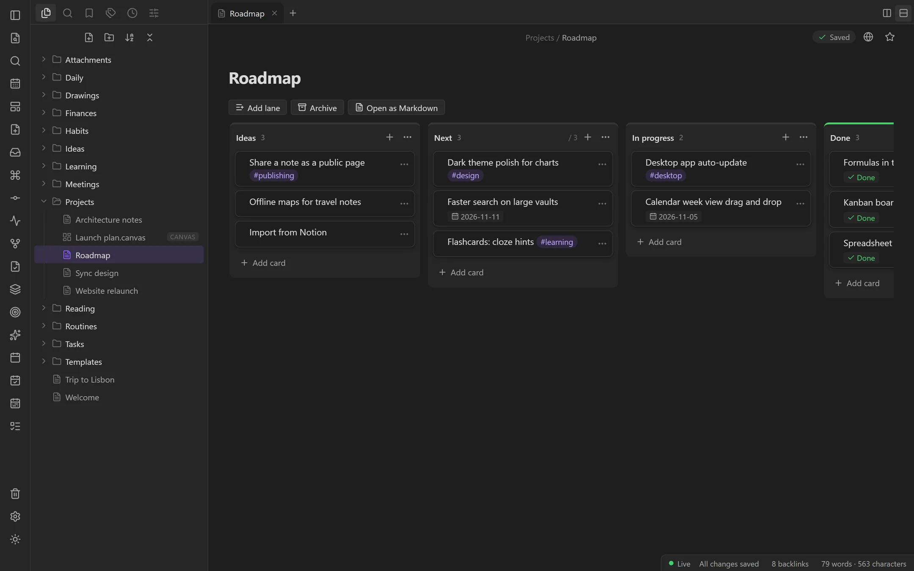<br>**Kanban boards** in the Obsidian Kanban plugin's Markdown format | 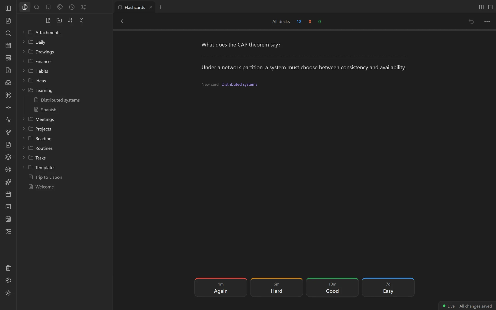<br>**Flashcards** written in notes, scheduled with FSRS |
| 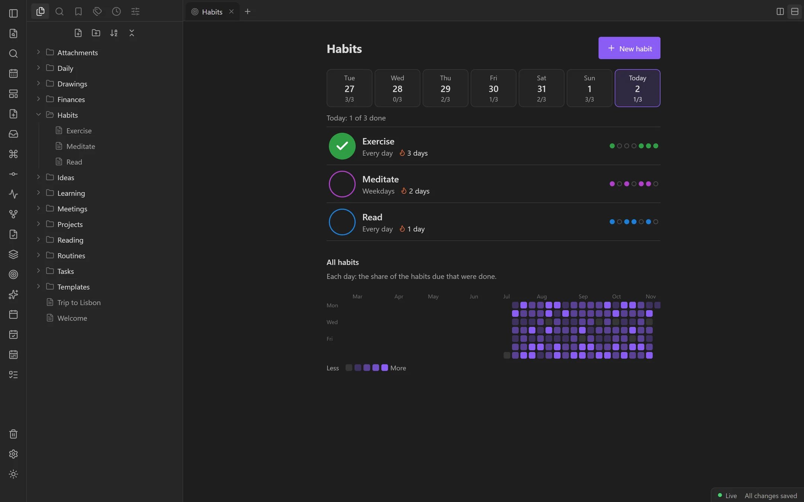<br>**Habits** checked in from daily notes, with streaks and a heatmap | 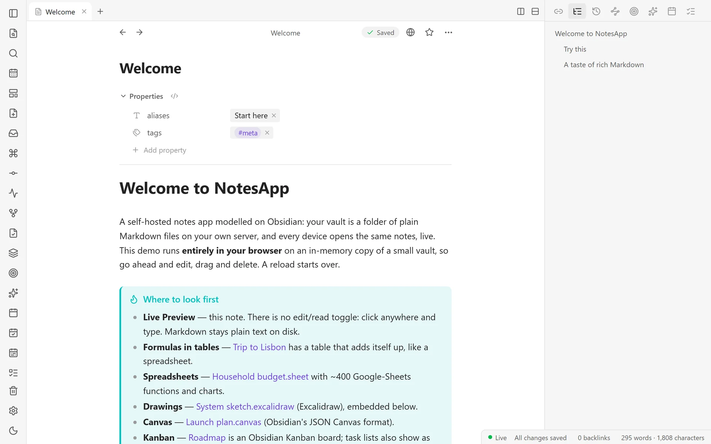<br>**Dark and light themes**, an outline, backlinks and properties |

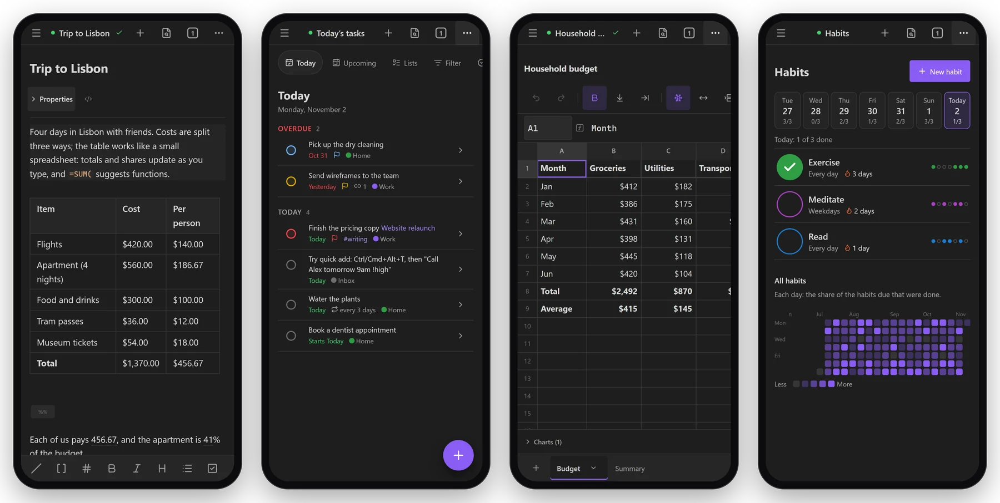

*Phone-first: the iPhone home-screen app has a keyboard-aware editor and toolbar, a drawer, quick capture and a share-sheet target.*

The complete list, from search syntax to backups, is in **[docs/FEATURES.md](docs/FEATURES.md)**.

## Architecture

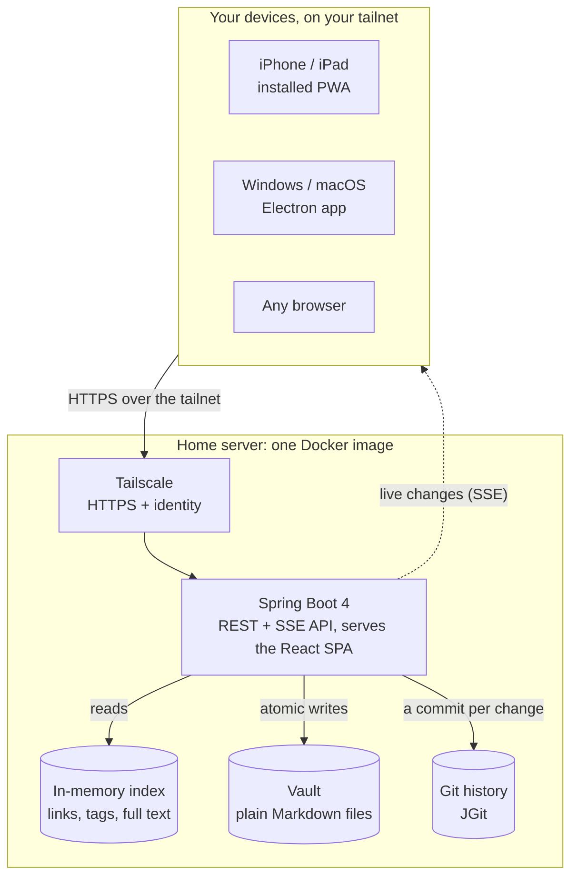

A Spring Boot backend (Java 21, run on JDK 25 with an AOT cache) serves a REST and Server-Sent Events API and the React single-page app from one image. There is **no database**: the vault is a directory of files, an in-memory index of links, tags and full text is built at startup and kept current by a file watcher (edits made over SSH or in Obsidian show up live), and JGit commits every change into the vault's own `.git`. There is no app login either: the app listens only inside Tailscale's network namespace, `tailscale serve` terminates HTTPS and passes the caller's identity, and host and identity allowlists are the security boundary.

The frontend is React 19 + TypeScript on Vite. Each file type (notes, spreadsheets, drawings, canvases, task lists, PDFs) plugs into a view registry and loads as its own lazy chunk, so the first load stays under a **350 KiB gzip budget that the build enforces**. The full design is in [docs/DESIGN.md](docs/DESIGN.md) and the API contract in [docs/API.md](docs/API.md).

## Tech stack

| Area | Technologies |
|---|---|
| **Backend** | Java 21, Spring Boot 4.1, JGit, Server-Sent Events, lib-recur (RRULE), PDFBox, the Anthropic Java SDK (Ask your vault, optional) |
| **Frontend** | React 19, TypeScript, Vite, CodeMirror 6, TanStack Query, Zustand, HyperFormula, Glide Data Grid, Excalidraw, Mermaid, KaTeX, PDF.js, d3-force, ts-fsrs, QuickJS (sandboxed scripts) |
| **Apps** | Installable PWA with a service worker and offline mode; Electron desktop app for Windows and macOS; browser extension, bookmarklet and iOS Shortcut web clipper |
| **Infrastructure** | Docker (multi-stage, amd64 + arm64), GitHub Actions, GitHub Container Registry, Watchtower, Tailscale, restic backups to B2 or S3, ntfy alerts, GitHub Pages for the demo |

## How it's built and tested

- **3,819 automated tests** at the time of writing: 1,149 backend (JUnit 5, Spring Boot tests and integration tests on a real temporary vault), 2,575 frontend (Vitest and Testing Library, 251 files, including one that boots the whole app on the demo vault), 69 for the web clipper and 26 for the desktop app.
- **CI on every pull request and push** ([ci.yml](.github/workflows/ci.yml)): backend tests on JDK 21 and JDK 25, frontend type checks, lint, tests and production build (with the bundle budget), the demo build, the clipper, and the deploy and backup scripts (in dash and BusyBox); pull requests also build the Docker image.
- **Zero-touch deploys.** A push to `main` publishes multi-arch images, Watchtower on the server picks them up within minutes, and open tabs reload themselves onto the new build. A weekly rebuild picks up base-image fixes; Dependabot proposes updates; every action is pinned by commit SHA.
- **Contracts written down first.** [docs/API.md](docs/API.md) is the binding API contract (a test keeps its type section identical to the frontend's `types.ts`), and [docs/DESIGN.md](docs/DESIGN.md) records each design decision and its reasons.
- **Ops built in.** A status page, app alerts to ntfy, nightly encrypted backups with a restore drill, and an optional mirror of the vault's history to a private GitHub repository.

## Self-hosting

You need a Linux server with Docker and [Tailscale](https://tailscale.com). The image is `ghcr.io/rjgehan/notesapp`.

- **CasaOS:** paste one compose file into the CasaOS UI and run two commands. Step by step in **[docs/CASAOS.md](docs/CASAOS.md)**.
- **Docker Compose:** the full runbook (first deploy, Tailscale, updates, backups, rollback, troubleshooting) is **[docs/DEPLOY.md](docs/DEPLOY.md)**.

Optional extras are off until you set them up: nightly backups, alerts, the GitHub mirror, voice note transcription, Ask your vault with Claude, and public publishing through Tailscale Funnel.

## Desktop app

Windows and macOS installers are attached to the **[GitHub Releases](https://github.com/rjgehan/notesapp/releases)** named `desktop-v…` (`Voyager-Setup-<version>.exe`, `Voyager-<version>-mac.dmg`). The app is a thin, sandboxed window around your own server with a tray icon, a system-wide quick-capture shortcut (`Ctrl+Shift+Space` / `Cmd+Shift+Space`), native notifications and launch at login. The installers are not code-signed yet; [docs/DESKTOP.md](docs/DESKTOP.md) has the SmartScreen and Gatekeeper steps.

## Run it locally

Needs JDK 21 and Node 24. Docker is not needed.

```powershell
# Terminal 1: the API on http://127.0.0.1:8080, with a throwaway vault in .\dev-vault
cd backend; .\mvnw.cmd spring-boot:run "-Dspring-boot.run.profiles=dev"

# Terminal 2: the app on http://localhost:5173
cd frontend; npm install; npm run dev
```

Or run the frontend alone on the in-memory mock (`$env:VITE_MOCK_API = "1"; npm run dev`), or build the live demo (`npm run build:demo`). Ports, checks and conventions are in [docs/DEVELOPMENT.md](docs/DEVELOPMENT.md).

## Documentation

| Document | What it covers |
|---|---|
| [User guide](docs/guide/index.md) | Using the app, task by task: the same pages are its built-in **Help** (the ribbon, the phone's drawer and ⋯ menu, or *Open help* in the command palette) |
| [FEATURES.md](docs/FEATURES.md) | Everything the app does |
| [DESIGN.md](docs/DESIGN.md) | The technical design, backend and frontend (decisive) |
| [API.md](docs/API.md) | The REST and SSE contract between backend and frontend |
| [DEVELOPMENT.md](docs/DEVELOPMENT.md) | Local development, repository layout, checks, how a change reaches the server |
| [DEPLOY.md](docs/DEPLOY.md) | Home-server runbook: first deploy, operations, backups, troubleshooting |
| [CASAOS.md](docs/CASAOS.md) | Installing on CasaOS with one compose file |
| [DESKTOP.md](docs/DESKTOP.md) | The Windows and macOS desktop app |
| [CLIPPER.md](docs/CLIPPER.md) | The web clipper: browser extension, bookmarklet, iPhone Shortcut |
| [ACCESSIBILITY.md](docs/ACCESSIBILITY.md) | WCAG 2.2 AA status, how it is tested, known gaps |
| [PERFORMANCE.md](docs/PERFORMANCE.md) | Performance at scale: the load-test kit, results before and after, known limits |
| [SECURITY.md](docs/SECURITY.md) | Threat model, the trust boundaries of each deployment layout, the security audit's findings, residual risks and hardening advice ([SECURITY.md](SECURITY.md): how to report a vulnerability) |
| [ROADMAP.md](docs/ROADMAP.md) | Every roadmap item, what each one became, and the proposals still open |
| [BRAND.md](BRAND.md) | The name Voyager and its story, the voice, the colours and the icon |

## Licence

Voyager is free software under the GNU General Public License, version 3 only ([LICENSE](LICENSE), SPDX `GPL-3.0-only`). The spreadsheet formula engine, HyperFormula, is used under its GPL-3.0 licence option, which is why the whole repository is GPL-3.0 (decided 2026-10-17, [ROADMAP](docs/ROADMAP.md) item 6). Running your own image needs nothing further; if you ever distribute Voyager, distribute its source under the same licence.

Third-party packages and their licences are listed in [THIRD_PARTY_NOTICES.md](THIRD_PARTY_NOTICES.md). It is generated: after changing dependencies, run `node scripts/third-party-notices.mjs` from the repository root.
